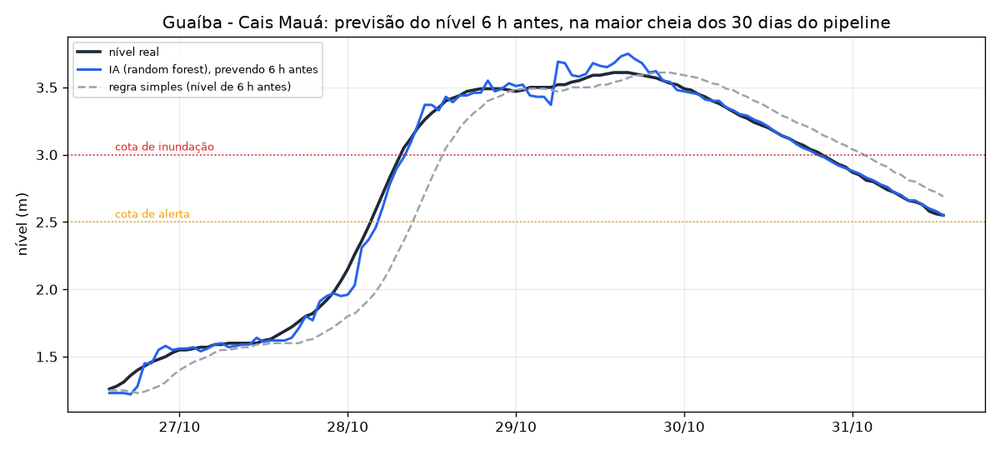

# Área 1 — IA e automação

A IA responde às duas perguntas da enchente:
- **"o rio vai subir?"**: prevê o nível de cada rio para daqui a 6 h e avisa antes de ele chegar à cota;
- **"para onde eu vou?"**: recomenda um abrigo que vai ter vaga quando a pessoa chegar e que não vai alagar.

Ela também escreve o alerta em linguagem simples para SMS, push, WhatsApp e Defesa Civil.

| Critério do edital | Pontos | Onde está |
|---|---|---|
| IA aplicada que resolve parte do problema | 1,5 | Previsão em 6 h ([`treino.py`](ia/treino.py), [`previsao.py`](ia/previsao.py)) e recomendação de abrigo com o risco previsto ([`abrigos.py`](ia/abrigos.py)), servidas pela [API](#api) |
| Prompts, agentes ou automação documentados | 1 | [Prompt de sistema](prompts/sistema.md) e [exemplos](prompts/exemplos.md) do gerador de mensagens; automação do [vigia](#4-automação-o-vigia) |
| Demonstração com entrada e saída | 0,5 | [`relatorio/demo.md`](relatorio/demo.md) (momento real do histórico), Swagger em http://localhost:8000/docs, `POST /mensagens/gerar` |
| Lógica e ganho com métrica antes/depois | 1 | [`relatorio/RELATORIO.md`](relatorio/RELATORIO.md): IA × regra simples (erro e antecedência) e abrigo "mais próximo" × IA |

## Como rodar e demonstrar

A API sobe junto com o resto (veja o [README principal](../README.md#como-rodar)):

```bash
docker compose up -d --build --wait
```

Na primeira vez, o build da imagem da IA treina o modelo (menos de 1 minuto). Depois disso:

- **Swagger** (testar todas as rotas pelo navegador): http://localhost:8000/docs
- **Previsão dos rios agora**:

```bash
curl -s localhost:8000/previsao
```

- **Onde ficar seguro** (família de 4 no bairro Navegantes):

```bash
curl -s 'localhost:8000/abrigos/recomendacao?bairro=navegantes&pessoas=4'
```

- **Mensagem de alerta**, com a entrada em JSON e a saída por canal:

```bash
curl -s -X POST localhost:8000/mensagens/gerar -H 'Content-Type: application/json' -d @area1-ia/prompts/exemplo_entrada.json
```

- **Automação ao vivo:** o vigia avisa sozinho quando a previsão cruza uma cota (Ctrl+C sai).

```bash
docker compose logs -f api
```

- **Relatório com métricas e gráficos.** Ele lê o pipeline e grava em `relatorios/ia/`, fora do git. A
  versão de referência, citada no PDF, está em [`relatorio/`](relatorio/RELATORIO.md); para atualizá-la,
  copie os arquivos de `relatorios/ia/` para lá.

```bash
docker compose --profile ferramentas run --rm ia-relatorio
```

A simulação em tempo real é acelerada 600× (1 s real = 10 min simulados). Por isso as
"6 horas" da previsão passam em 36 segundos na demonstração.

## 1. Previsão do nível do rio para daqui a 6 h

**Antes (regra simples, ou persistência):** "daqui a 6 h o nível é igual ao de agora". Com
essa regra, o alerta só sai quando o rio já passou da cota.

**Depois (IA):** um modelo por rio aprende quanto o nível vai **subir ou descer** em 6 h.

- **Entradas:**
  - nível atual;
  - variação na última hora;
  - chuva de 1, 6 e 24 h.
- **Features:** as mesmas de `gold.v_ml_features` (área 2).
- **Treino:** 24 meses simulados com o mesmo simulador da fase 1 e outras sementes (1001 a 1024). Os 30 dias do pipeline têm só 1 ou 2 cheias por rio, pouco para treinar e testar.
- **Escolha do modelo:** três candidatos por rio:
  - a própria regra simples;
  - regressão linear;
  - random forest (scikit-learn).

  A escolha é por validação cruzada por semente (`GroupKFold`): a mesma série nunca fica no treino e na validação. A IA só substitui a regra simples onde provou ser melhor.
- **Teste final:** nos 30 dias do pipeline (semente 42), que o modelo **nunca viu**.
- **Ao vivo:** a visão `gold.v_ml_features_atual` (migrações 007 e 008) calcula as mesmas features a partir das últimas leituras (até 3 dias).
- **Garantia de que treino e uso calculam igual:** o teste de integração CT-32 confere que o Python (`ia/features.py`) e o SQL dão os mesmos números.

Resultado do teste (do [relatório](relatorio/RELATORIO.md)). A antecedência é o número de
horas seguidas em que a previsão já avisava quando o rio passou da cota, limitado ao
horizonte de 6 h: um aviso mais cedo que isso previa a cota para antes da hora certa.

| Rio | Modelo usado | Erro médio da IA | Erro da regra simples | Erro caiu | Antecedência do alerta |
|---|---|---|---|---|---|
| Guaíba | random forest | 2,2 cm | 7,5 cm | **71%** | **4 h e 5 h** antes da cota de alerta; **5 h** antes da de inundação |
| Gravataí | random forest | 3,7 cm | 9,4 cm | **61%** | **6 h** antes da cota de alerta |
| Dilúvio | regra simples | 23,2 cm | 23,2 cm | 0% | — |



**Por que o Dilúvio fica com a regra simples:** o arroio sobe e desce em 1 a 2 horas, então
o nível dele em 6 h depende da chuva que ainda vai cair. Na validação, os modelos
diminuíram os erros grandes, mas aumentaram o erro médio. Pela regra combinada antes do
teste, ficou a regra simples. É uma limitação dita com franqueza: para o Dilúvio, o aviso
útil é o da própria chuva.

**Alarmes falsos:**
- Gravataí: 2, curtos (1 a 2 h), numa chuva durante a descida do rio;
- Guaíba: 1, na cota de inundação.

## 2. Onde ficar seguro

Um abrigo é **apto** quando:
- está ativo, não é de demonstração e tem leitura recente de ocupação;
- tem vaga para o grupo agora **e quando a pessoa chegar**: a IA desconta quem está chegando, pela tendência da última hora (`gold.v_abrigo_tendencia`) × tempo de caminhada;
- não está em área de risco com o rio da região em alerta, **agora ou previsto pela IA para as próximas 6 h**. "Agora" é o alerta da fase 1. Uma previsão feita com leitura velha não vale: fica só o agora.

Entre os aptos, o mais perto a pé vem primeiro: haversine × 1,3, a 4 km/h. A resposta explica
por que os abrigos mais próximos foram evitados ("deve lotar antes de você chegar").

**Privacidade (LGPD):** a posição exata não sai do celular.
- `GET /abrigos` avalia todos os abrigos **agora** e devolve `minutos_ate_lotar` (no ritmo da última hora). No aparelho, o app descarta os que lotam antes de a pessoa chegar (`minutos_a_pe > minutos_ate_lotar`) e ordena os aptos pela distância.
- `GET /abrigos/recomendacao` recebe só o bairro e usa o centro dele.

**Métrica antes/depois:**
- **Cenário:** 200 pontos de partida nos 11 bairros de risco alto × 231 horas de crise do histórico, com famílias de 4. Cada escolha é conferida com o que aconteceu depois. O "alerta de agora" repete a regra da fase 1 hora a hora, como na API.
- **Estratégias comparadas:**
  - A, sem o sistema: o abrigo mais próximo;
  - B, regra da fase 1: vaga e alerta de agora;
  - C, a IA.

| Estratégia | Lotado na chegada | Abrigo alagou | Falha | Caminhada média |
|---|---|---|---|---|
| A. Mais próximo | 5,2% | 11,2% | **15,9%** | 24 min |
| B. Regra da fase 1 | 0,3% | 0,2% | **0,5%** | 37 min |
| C. IA | 0,1% | 0,0% | **0,1%** | 38 min |

Sem o sistema, 1 em cada 6 famílias iria para um abrigo cheio ou que alagou. O custo é andar
14 minutos a mais. A regra da fase 1 já resolve a maior parte; a IA zera os casos de abrigo
que alaga, porque enxerga a cheia antes de o alerta oficial abrir.

## 3. Mensagens em linguagem simples (prompts)

O grupo não tem API de LLM, e o avaliador também não teria a chave. Por isso a IA generativa
é **simulada** por modelos de texto que seguem um prompt de sistema documentado. O edital
aceita IA "implementada ou simulada".

- [`prompts/sistema.md`](prompts/sistema.md): o prompt, com as regras de linguagem simples, o formato por canal e o formato dos fatos de entrada.
- [`prompts/exemplos.md`](prompts/exemplos.md): exemplos de entrada e saída para cada intenção (few-shot).
- [`ia/mensagens.py`](ia/mensagens.py): passa por intenção, texto por canal e **verificação** automática das regras:
  - tamanho de cada canal;
  - frases curtas;
  - sem jargão;
  - ação no começo;
  - 199 e abrigo quando é para sair.

  Trocar por um LLM é mudar só a função `gerar()`, e a verificação continua valendo.

## 4. Automação: o vigia

Uma thread da API roda a cada 2 s:
1. calcula a previsão de cada rio;
2. aplica ao **nível previsto** a mesma regra de alerta da fase 1 (abre, escala e fecha com folga de 0,10 m);
3. quando abre ou escala, gera o SMS e registra no log;
4. se a estação fica sem leitura recente, encerra o alerta dela ("sem_dados"), em vez de deixá-lo aberto para sempre.

Exemplo de linha do log:

```
[vigia] abrir alerta pela previsão em gra-sarandi: alerta ANTECIPADO (a previsão está pior que agora) | agora 3.28 m (atencao), em 6 h 3.50 m (alerta) | SMS: DEFESA CIVIL: Prepare-se para sair de casa. ...
```

O estado aparece em `GET /alertas`. Na demonstração de 07/11, o vigia avisou antes de o rio
passar da cota (1 s real = 10 min simulados). Na atenção do Guaíba o aviso saiu 7,5 h antes,
mais cedo que o horizonte de 6 h: pela regra do relatório, isso conta como 6 h.

| Rio / cota | Vigia avisou | Rio passou da cota | Antecedência |
|---|---|---|---|
| Guaíba, atenção | 14:08:29 | 14:09:14 | 45 s ≈ 7,5 h simuladas |
| Guaíba, alerta | 14:09:27 | 14:09:57 | 30 s ≈ 5 h simuladas |
| Gravataí, atenção | 14:09:29 | 14:09:55 | 26 s ≈ 4,3 h simuladas |

## API

FastAPI em `127.0.0.1:8000`. Lê só a camada gold, com o usuário `ia_ro`. O CORS libera o app
React da fase 3 (`API_CORS_ORIGENS` no `.env`). Banco fora do ar responde 503 em qualquer rota.

| Rota | O que faz |
|---|---|
| `GET /saude` | Banco acessível, modelo carregado e situação do vigia |
| `GET /previsao` · `/previsao/{estacao_id}` | Nível atual, previsto em 6 h, regra simples, situação atual e prevista, tendência e features de entrada |
| `GET /modelo` | Modelo escolhido por rio e erro na validação cruzada |
| `GET /modelo/avaliacao` | Teste **ao vivo** contra `gold.v_ml_features`: erro e antecedência, IA × regra simples |
| `GET /bairros` | Bairros aceitos na recomendação |
| `GET /abrigos?pessoas=` | Todos os abrigos avaliados agora: aptidão, `minutos_ate_lotar`, risco previsto e motivo (o app termina no celular) |
| `GET /abrigos/recomendacao?bairro=&pessoas=` | Os 3 aptos mais perto, os evitados com o motivo e a mensagem pronta |
| `GET /alertas?bairro=` | Alertas do vigia e mensagens de cada rio fora do normal |
| `POST /mensagens/gerar` | Demonstração: fatos (entrada) → mensagens por canal + verificação (saída) |

## Testes

| Tipo | Onde | O que cobre |
|---|---|---|
| Unidade (174) | [`tests/`](tests) | Features iguais à regra SQL, métricas e antecedência, treino reproduzível, cada motivo de exclusão de abrigo, cenários A × B × C com o alerta da fase 1, todas as combinações de mensagem (inclusive o pior caso de tamanho), vigia com a mesma regra da fase 1, API com repositório em memória (503, dado velho, abrigo inativo), relatório |
| Integração (6) | [`test_integracao.py`](../area4-devops/testes/test_integracao.py) (it15 a it20) | API saudável, previsão dos 3 rios, recomendação só com aptos, **paridade Python × SQL das features**, `ia_ro` só lê o gold, mensagem passa nas regras |

## Arquivos

| Arquivo | Para quê |
|---|---|
| `ia/features.py` | Features horárias (Python puro, mesma regra de `gold.v_ml_features`) |
| `ia/dados_simulados.py` | Histórico de treino: 24 meses simulados |
| `ia/treino.py` | Validação cruzada, escolha por rio e gravação do modelo (`python -m ia.treino`) |
| `ia/avaliacao.py` | MAE, RMSE, antecedência e alarmes falsos |
| `ia/previsao.py` | Carrega o modelo e prevê |
| `ia/abrigos.py` · `ia/cenarios_abrigos.py` | Recomendação e a métrica A × B × C |
| `ia/mensagens.py` | Mensagens em linguagem simples + verificação |
| `ia/vigia.py` | Automação do alerta antecipado |
| `ia/repositorio.py` · `ia/servicos.py` · `ia/api.py` | Acesso ao gold, regras juntas e rotas |
| `ia/relatorio.py` | Gera `relatorio/` (`RELATORIO.md`, `metricas.json`, gráficos, `demo.md`) |

## Limitações (sinceridade no pitch)

- Treino e teste vêm do mesmo simulador, com sementes diferentes. Num caso real, o treino usaria a série histórica oficial dos rios.
- O Dilúvio fica com a regra simples (veja acima).
- A ocupação "na chegada" usa a tendência da última hora; picos súbitos de procura não são previstos.
- A caminhada é estimada (linha reta × 1,3), sem mapa de ruas alagadas.
- Os números do relatório variam um pouco a cada novo histórico (`docker compose down -v`), porque o agrupamento por hora depende do minuto em que o histórico foi gerado.

## Uso de IA generativa no desenvolvimento

O código desta área foi escrito com o Claude (Anthropic), via Claude Code, a partir de pedidos como:
- "proponha como prever o nível do rio em 6 h com scikit-learn, sem vazamento temporal, e compare com a persistência";
- "a recomendação de abrigo deve usar a previsão e não mandar a pessoa para abrigo que vai lotar; meça contra o mais próximo";
- "gere mensagens de alerta em linguagem simples sem depender de API, com as regras verificadas por testes".

O grupo revisou, executou e testou tudo.
