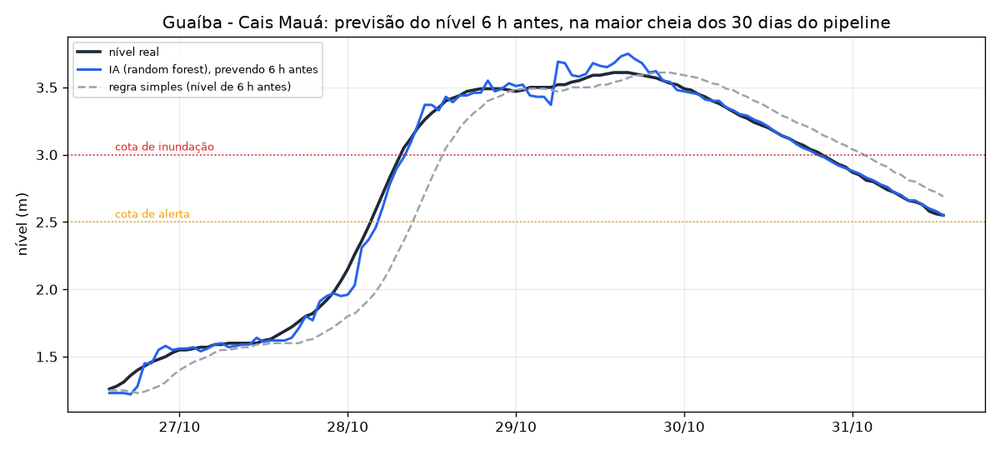
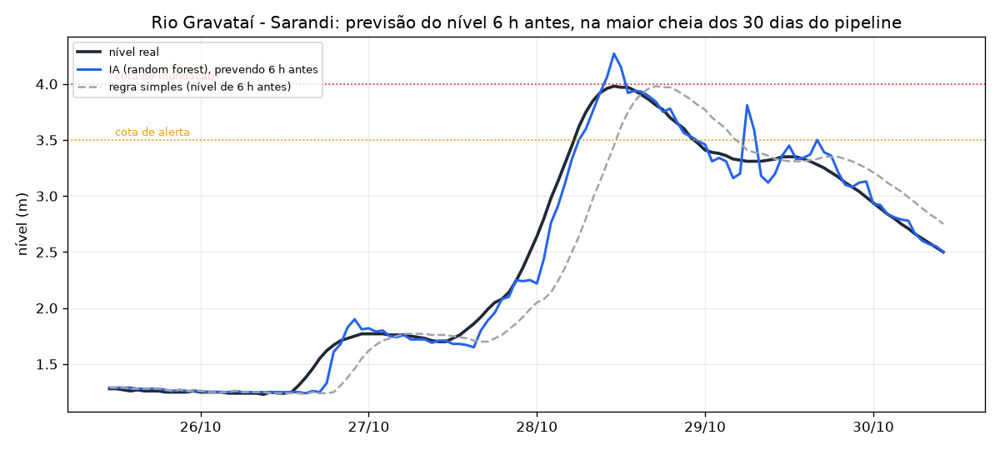
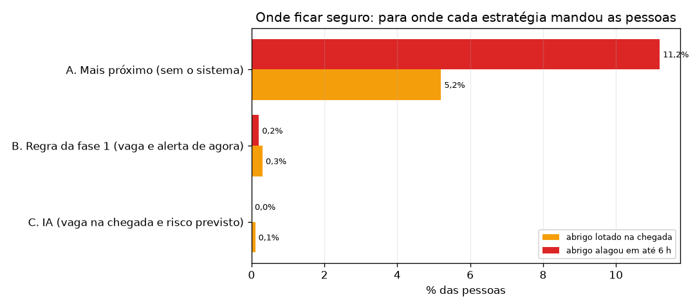

# Relatório da IA — previsão de cheia e "onde ficar seguro"

Gerado em 07/11/2026 11:53 (horário de Brasília) por `python -m ia.relatorio`, com os dados do pipeline (camada gold). Para gerar de novo: `docker compose --profile ferramentas run --rm ia-relatorio`.

## 1. Previsão do nível do rio para daqui a 6 h

**Antes (regra simples / persistência):** "daqui a 6 h o nível é igual ao de agora". **Depois (IA):** modelo treinado com 24 meses simulados, testado nos dados do pipeline, que ele nunca viu (720 horas por rio, de 08/10 10h a 07/11 09h, `gold.v_ml_features`).

| Rio | Modelo usado | Erro médio (MAE) IA | MAE regra simples | Erro caiu | RMSE IA | RMSE regra simples | Erro caiu |
|---|---|---|---|---|---|---|---|
| Arroio Dilúvio - Av. Ipiranga | regra simples | 0,232 m | 0,232 m | 0,0% | 0,466 m | 0,466 m | 0,0% |
| Rio Gravataí - Sarandi | random forest | 0,037 m | 0,094 m | 60,6% | 0,076 m | 0,184 m | 58,7% |
| Guaíba - Cais Mauá | random forest | 0,022 m | 0,075 m | 70,7% | 0,042 m | 0,135 m | 68,9% |

### Antecedência do alerta

Quando o rio passou da cota, há quantas horas seguidas a previsão já avisava? A regra simples só percebe quando o rio já passou (0 h).

| Rio | Cota | Vezes que o rio passou da cota | Antecedência da IA | Antecedência da regra simples | Alarmes falsos da IA |
|---|---|---|---|---|---|
| Arroio Dilúvio - Av. Ipiranga | alerta (2,50 m) | 2 | 0 h, 0 h (média 0,0 h) | 0 h | 0 |
| Rio Gravataí - Sarandi | alerta (3,50 m) | 1 | 6 h (média 6,0 h) | 0 h | 2 |
| Guaíba - Cais Mauá | alerta (2,50 m) | 2 | 4 h, 5 h (média 4,5 h) | 0 h | 0 |
| Guaíba - Cais Mauá | inundação (3,00 m) | 1 | 5 h (média 5,0 h) | 0 h | 1 |

### Validação cruzada no treino (erro médio, MAE)

GroupKFold(4) por semente: a mesma série nunca fica no treino e na validação. A regra simples também é candidata: a IA só substitui a persistência no rio em que provou ser melhor.

| Rio | Regra simples | Regressão linear | Random forest | Escolhido |
|---|---|---|---|---|
| Arroio Dilúvio - Av. Ipiranga | 0,190 m | 0,207 m | 0,206 m | **regra simples** |
| Rio Gravataí - Sarandi | 0,089 m | 0,035 m | 0,032 m | **random forest** |
| Guaíba - Cais Mauá | 0,074 m | 0,022 m | 0,019 m | **random forest** |

## 2. Onde ficar seguro: recomendação de abrigo

200 pontos de partida nos bairros de risco alto × 231 horas de crise do histórico = 46200 escolhas por estratégia (grupos de 4 pessoas). Cada escolha é conferida com o que aconteceu depois.

| Estratégia | Lotado na chegada | Abrigo alagou | **Falha (um ou outro)** | Sem abrigo apto | Distância média | Tempo a pé médio |
|---|---|---|---|---|---|---|
| A. Mais próximo (sem o sistema) | 5,2% | 11,2% | **15,9%** | 0,0% | 1,24 km | 24 min |
| B. Regra da fase 1 (vaga e alerta de agora) | 0,3% | 0,2% | **0,5%** | 0,0% | 1,89 km | 37 min |
| C. IA (vaga na chegada e risco previsto) | 0,1% | 0,0% | **0,1%** | 0,0% | 1,95 km | 38 min |

**Leitura:** sem o sistema, 15,9% das famílias iriam para um abrigo lotado ou que alagou. A regra da fase 1, que só olha o agora, baixa para 0,5%; a IA, que olha a vaga na chegada e o rio previsto para 6 h, para 0,1%. O custo é andar em média 14 min a mais que até o abrigo mais próximo.
