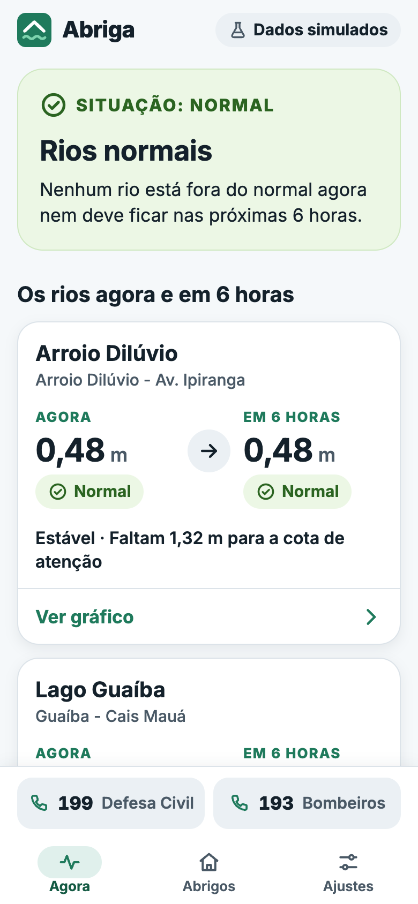
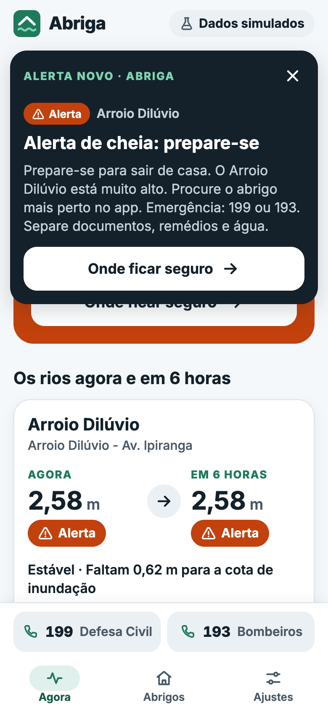
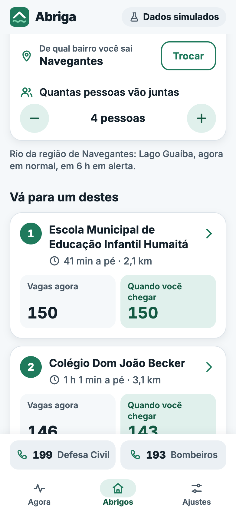
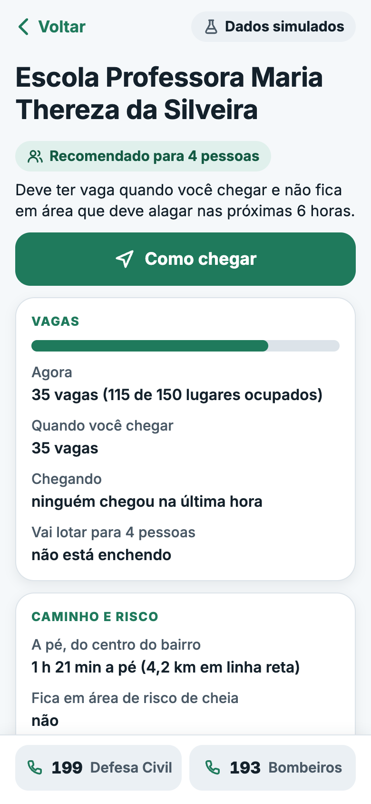
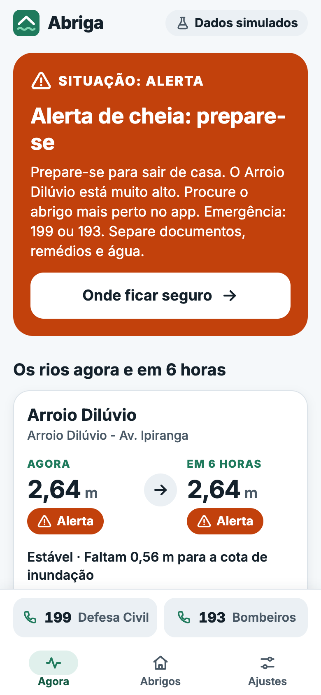
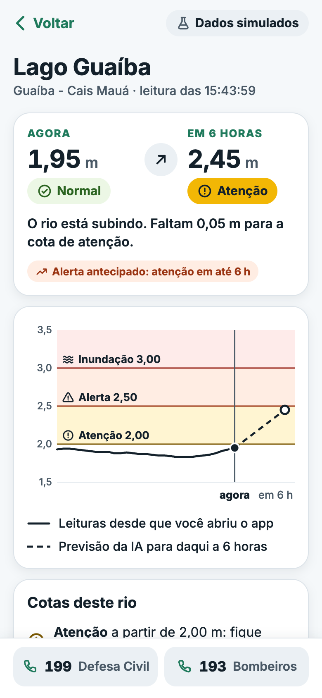
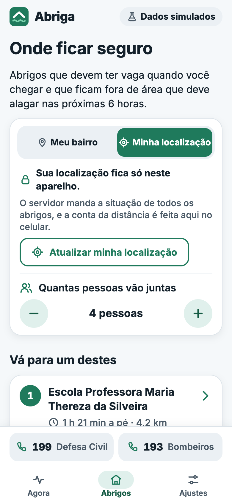
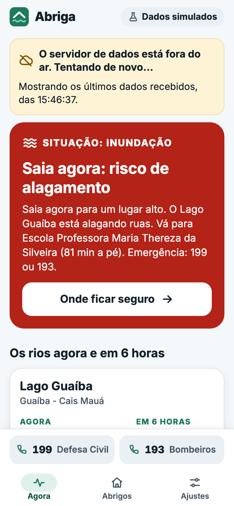
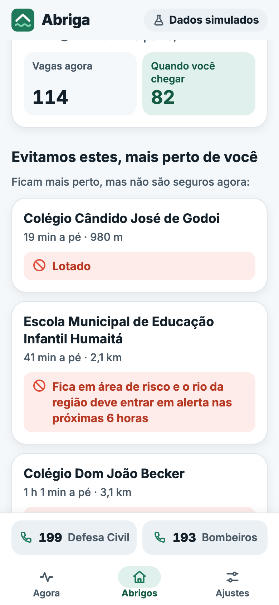
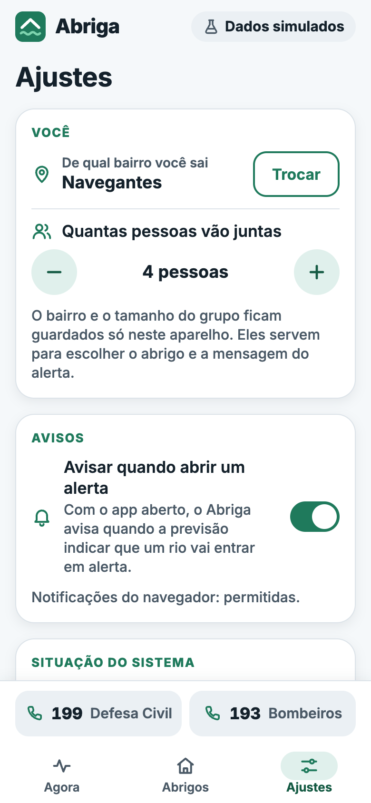

# Abriga — app do cidadão (área 3)

App em React Native com Expo (SDK 58). Ele mostra a situação dos rios de Porto Alegre e avisa
quando a IA prevê a cheia. Também indica um abrigo que vai ter vaga quando a pessoa chegar e que
fica fora da área que deve alagar. O mesmo código roda no navegador e no celular. A demonstração
e o `docker compose up` usam a versão web, em largura de celular.

> **Dados simulados.** Os rios, a chuva e a ocupação dos abrigos vêm do simulador do projeto. O Abriga
> não é um canal oficial: em emergência real, ligue **199** (Defesa Civil) ou **193** (Bombeiros).

| Agora (rios normais) | Aviso de alerta novo | Onde ficar seguro | Detalhe do abrigo |
|---|---|---|---|
|  |  |  |  |

| Agora (na cheia) | Rio (gráfico) | Minha localização | Sem servidor |
|---|---|---|---|
|  |  |  |  |

| Evitados, com o motivo | Ajustes |
|---|---|
|  |  |

## Telas

| Tela | Rota | O que mostra |
|---|---|---|
| **Agora** | `/` | A pior situação entre os rios, agora ou em 6 h. O texto vem da IA, em linguagem simples, para o bairro salvo. Um cartão por rio mostra o nível agora e em 6 h, a situação em cor e em palavra, a tendência e os selos "Alerta antecipado", "Leitura atrasada" e "Dados incompletos" |
| **Rio** | `/rio/[id]` | Gráfico com as faixas das cotas, as leituras recebidas desde que o app abriu e a previsão de 6 h. Explica o modelo usado (no Dilúvio, a regra simples) |
| **Onde ficar seguro** | `/abrigos` | Os 3 abrigos recomendados, com o tempo a pé e as vagas agora e na chegada. Mostra também os evitados que ficam mais perto, com o motivo. A distância sai do centro do bairro ou da localização do aparelho |
| **Detalhe do abrigo** | `/abrigo/[id]` | Ocupação, vagas na chegada, pessoas chegando por hora, em quanto tempo lota, risco da região agora e em 6 h. O botão **Como chegar** abre o mapa a pé |
| **Ajustes** | `/ajustes` | Bairro e tamanho do grupo, avisos ligados ou desligados (com a permissão de notificação), situação do servidor e Sobre |

**Fluxo completo:** o rio sobe → a IA prevê a cheia e o vigia abre o alerta → o app avisa →
a pessoa toca em **Onde ficar seguro** → escolhe o 1º abrigo → toca em **Como chegar**.

## Como rodar

### Com o Docker (o jeito da entrega)

Na raiz do repositório, `docker compose up -d --build --wait` (veja o [README principal](../../README.md#como-rodar)).
Abra **<http://localhost:5173>**.

- No computador, deixe a janela estreita ou use o modo celular do navegador. No Chrome, é F12 e depois o ícone de celular (Ctrl+Shift+M).
- Na primeira vez, o app pede o bairro. Escolha, por exemplo, **Navegantes**, que fica na beira do Guaíba e mostra bem o alerta.

O build da imagem instala as dependências e exporta a versão web (`npx expo export -p web`).
O resultado é servido por um nginx sem root. O nginx também repassa `/api` para a API de IA,
então o app e a API ficam no mesmo endereço e não precisam de CORS.

### Em desenvolvimento (Node 22.13 ou mais novo)

Com o Compose rodando (a API fica em `localhost:8000`):

```bash
npm install
```

```bash
npx expo start --web
```

O Metro abre o app em `http://localhost:8081`. Fora do Docker, o app chama a API em
`http://localhost:8000`, e o `API_CORS_ORIGENS` da API já libera essa origem.
Para usar outro endereço, defina `EXPO_PUBLIC_API_URL` antes do `expo start`.

### No celular (Expo Go)

O app usa `expo-location` e `expo-notifications`, que funcionam no celular, e os testes cobrem
o caminho do celular. Mas nesta entrega ele **só rodou no navegador**, por dois motivos:

- em 09/11/2026, o Expo Go das lojas ainda não roda o SDK 58;
- a API só aceita conexões da própria máquina (`127.0.0.1`), então o celular não a alcança.

## Roteiro da demonstração

Os tempos foram medidos com `SIM_VELOCIDADE=600`, em que 1 segundo real equivale a 10 minutos simulados.

1. Reinicie a cheia simulada:

   ```bash
   docker compose restart simulador
   ```

2. Uns 15 s depois, abra o app (ou recarregue a página) na tela **Agora**, com o bairro **Navegantes** e 4 pessoas.
   Como o restart volta o rio ao normal de uma vez, um app aberto antes mostraria esse degrau no gráfico do rio.
3. Por uns 4 minutos os rios ficam normais. Use esse tempo para mostrar as telas **Rio**, **Onde ficar seguro** e **Ajustes**.
4. Uns **4 min** depois do restart:
   - a IA prevê que o Guaíba chega à cota de atenção em 6 h e mostra o selo **Alerta antecipado**;
   - o vigia abre o alerta, e o app avisa com a faixa no topo e a notificação do navegador.

   O rio só passa da cota uns 50 s depois, cerca de 8 h simuladas.
5. Uns **5 min** depois do restart:
   - o vigia escala o Guaíba para **alerta**, cerca de 30 s (5 h simuladas) antes de o rio passar de 2,50 m;
   - a faixa diz **"Prepare-se: o rio vai subir"** e tem o botão **Onde ficar seguro**.
6. Toque em **Onde ficar seguro**: abrem os recomendados de Navegantes. Toque no 1º e depois em **Como chegar**.
7. (Opcional) Teste o GPS sem sair do lugar. No Chrome, abra o DevTools e vá em ⋮ → **More tools → Sensors**. Em **Location**, informe `-29.99363, -51.20077` (centro de Navegantes). Na tela Onde ficar seguro, toque em **Minha localização**.
8. (Opcional) Teste o aviso de erro:
   - com `docker compose stop api`, o app avisa que o servidor está fora do ar e continua mostrando os últimos dados;
   - com `docker compose start api`, ele volta sozinho.

A cena forte do vídeo fica entre 4 e 6 minutos depois do `restart`.

## Como funciona

### Atualização e erros

- **Intervalos:** o app usa o TanStack Query para pedir os dados de tempos em tempos.
  - rios e alertas: a cada 3 s;
  - abrigos: a cada 5 s, só com a tela aberta;
  - situação do servidor: a cada 10 s.
- **Falhas:** cada uma vira uma mensagem simples ([`cliente.ts`](src/api/cliente.ts)):
  - sem conexão;
  - servidor fora do ar (502, 503 ou 504);
  - tempo esgotado (8 s);
  - não encontrado;
  - pedido inválido.
- **Dado guardado:** se já havia um dado bom, o app continua mostrando esse dado com a hora dele e tenta de novo sozinho. Nunca fica tela branca.

### Aviso de alerta novo

- **Quando avisa:** o app confere os alertas do vigia a cada 3 s e avisa **uma vez** por alerta que abre ou escala com o app aberto ([`alertas.ts`](src/logica/alertas.ts)).
  - A chave do aviso é `estação + severidade + hora de abertura`.
  - O que já estava aberto quando o app abriu aparece na tela Agora, sem aviso.
  - Se vários alertas abrem ou escalam na mesma leitura, cada um ganha a sua notificação do sistema. A faixa mostra o mais grave e cita os outros ("Também: Rio Gravataí (atenção).").
- **Como avisa:**
  - a faixa no topo, em qualquer tela, com o texto de push da IA e o botão **Onde ficar seguro** (ou **Ver os rios**, quando é só atenção);
  - a notificação do sistema: no celular, uma notificação local; no navegador, a do próprio navegador, se a permissão foi dada em Ajustes. Tocar nela leva para a mesma tela da faixa e fecha a faixa.
- **Quem já procura abrigo:** se a pessoa já está em Onde ficar seguro ou no detalhe de um abrigo, um aviso que levaria para lá
  chega só como notificação. A faixa não cobre a lista, que já é a atual. Isso acontece na cheia simulada, quando o Guaíba e o Dilúvio
  escalam com poucos segundos de diferença.
- **Avisos desligados:** com os avisos desligados em Ajustes, o app não avisa.

### Abrigos perto de mim, sem enviar a posição (LGPD)

- **Pelo bairro:** o app chama `GET /abrigos/recomendacao?bairro=&pessoas=`, e a API calcula a distância a partir do centro do bairro.
- **Pela localização:** o app pega a posição do aparelho e chama só `GET /abrigos?pessoas=`. A conta é feita no celular ([`geo.ts`](src/logica/geo.ts)), com a mesma regra da IA ([`abrigos.py`](../../area1-ia/ia/abrigos.py)):
  - a distância em linha reta (haversine) × 1,3, a 4 km/h;
  - ficam fora os abrigos indisponíveis;
  - ficam fora os abrigos que a API marcou como não aptos;
  - ficam fora os que devem lotar antes de a pessoa chegar (`minutos_a_pe > minutos_ate_lotar`).
- **Teste de paridade:** um teste compara o resultado com o da função `recomendar()` do Python, gerado por [`scripts/paridade_geo.py`](scripts/paridade_geo.py).
- **A posição não sai do aparelho:**
  - não vai para nenhuma URL nem é gravada; fica só na memória até o app fechar;
  - **Como chegar** abre o Google Maps só com o destino, e o mapa usa a localização do próprio celular;
  - longe de Porto Alegre (mais de 30 km do centro) ou sem permissão, o app avisa e volta para o bairro.
- **Preferências:** o bairro, o tamanho do grupo e os avisos ficam só no aparelho (AsyncStorage; no navegador, `localStorage`).

### Identidade

O nome é **Abriga**, com logotipo próprio: um telhado branco acima de uma onda verde-clara, em fundo verde
(`#1F7A5C`). A fonte é a Inter. As cores, os textos e os espaços ficam em [`src/tema.ts`](src/tema.ts).
Os ícones de [`assets/`](assets) saem de [`scripts/gerar_icones.py`](scripts/gerar_icones.py). O app não usa
nome, brasão nem cores de órgão público e não se apresenta como a Defesa Civil: mostra só os textos de push
da IA, e um teste confere isso. A situação vem sempre com cor, palavra e ícone (normal, atenção, alerta,
inundação). Os botões têm 48 px ou mais e rótulos de acessibilidade em português.

## Testes e qualidade

```bash
npm run lint && npm run typecheck && npm test
```

São 112 testes em Jest com a Testing Library, sem chamar a rede. As respostas da API são capturadas
da API real e ficam em [`__fixtures__/`](__fixtures__).
O CI (job `app`) roda os três comandos e grava o relatório JUnit em `relatorios/app.xml`.

| Suíte | O que garante |
|---|---|
| `cliente` | URL da API em cada ambiente; 503, 502, sem conexão, tempo esgotado, 404 e 422 viram mensagens simples |
| `EstadoDaConsulta` | Carregando, erro sem dado e dado antigo com aviso (nunca tela branca) |
| `situacao`, `grafico` | Resumo dos rios igual ao da API, sem piscar; escala do gráfico com as cotas e a previsão |
| `estado` | Preferências guardadas e validadas; histórico em memória com limite |
| `logica-abrigos`, `paridade-geo` | Distância e tempo a pé iguais aos da IA; abrigo que lota antes de a pessoa chegar sai da lista; indisponíveis ignorados; limite de 3 |
| `alertas`, `aviso-de-alerta` | Avisa uma vez, escalar avisa de novo, o que já estava aberto não avisa; vários alertas na mesma leitura; faixa e notificação com a API mudando |
| `telas-agora-rio`, `telas-abrigos`, `telas-localizacao-ajustes` | As telas com a API falsa: fluxo Agora → abrigos → detalhe; nenhuma URL com a posição; "Como chegar" só com o destino; permissão negada e fora de Porto Alegre |

O teste de integração `test_it23_app_web_no_ar_e_api_pelo_proxy` (na suíte da raiz) confere o app no Compose:
o HTML, as rotas, a API pelo proxy e os cabeçalhos de segurança.

## Estrutura

```
src/app/            telas (expo-router: cada arquivo é uma rota)
  _layout.tsx         TanStack Query, pilha de telas e faixa de alerta novo
  (abas)/             Agora (index), Onde ficar seguro (abrigos) e Ajustes
  abrigo/[id].tsx     Detalhe do abrigo
  rio/[id].tsx        Rio (gráfico)
src/api/            cliente HTTP, tipos (espelho dos modelos da API) e consultas
src/logica/         regras puras e testadas: situação, geo, alertas, gráfico, rota, textos
src/estado/         preferências, histórico, posição, avisos e notificações
src/componentes/    cartões, faixas, seletores, gráfico, ícones
__tests__/  __fixtures__/  test-utils/
scripts/            paridade_geo.py (fixture do teste de paridade), gerar_icones.py
Dockerfile  nginx/  (build web + nginx sem root, proxy /api e cabeçalhos de segurança)
```

## Limitações (sinceridade no pitch)

- **Aviso só com o app aberto.** Push enviado pelo servidor, com o app fechado, está fora do escopo do PRD.
- **A mensagem do aviso é uma foto do momento.** No teste ao vivo, a faixa sugeriu o Humaitá. Segundos depois, a previsão do Gravataí piorou, e a lista já o mostrava como evitado. A lista de abrigos é sempre a atual, por isso o botão leva para ela.
- **O gráfico mostra só as leituras desde que o app abriu**, sem histórico guardado.
- **GPS no navegador só em contexto seguro** (`localhost` ou HTTPS). Pelo IP da rede, use o bairro.
- **A posição some ao recarregar a página**, porque fica só na memória. O detalhe de um abrigo aberto assim não promete vaga num abrigo que está enchendo e pede para refazer a conta em Minha localização.

## Uso de IA generativa no desenvolvimento

O app foi escrito com o Claude (Anthropic), via Claude Code, a partir de pedidos como:
- "confira as versões atuais do Expo e das bibliotecas antes de escolher, e monte o app para rodar no navegador pelo Docker";
- "calcule os abrigos perto de mim no celular, sem mandar a posição, com a mesma conta da IA e um teste que prove isso";
- "o app deve avisar uma vez quando o vigia abrir o alerta, e mostrar uma mensagem amigável quando a API cair";
- "meça no simulador quanto tempo o alerta chega antes da cheia e escreva o roteiro da demo".

O grupo revisou, executou e testou tudo. Os 112 testes do app, o job `app` do CI e o teste de integração
`it23` são a evidência de que tudo roda.
