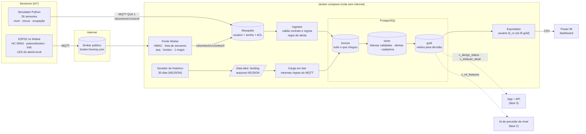

# Arquitetura — fase 1

## Fluxo de uma leitura

1. O sensor publica um JSON no contrato [`leitura.v1`](../contratos/leitura.v1.schema.json) no tópico `citizentech/v1/{origem}/{sensor_id}`.
2. O Mosquitto confere usuário, senha e permissão. O simulador só publica em `sim/`; a ponte só publica em `wokwi/`.
3. O ingestor processa a leitura:
   1. Grava a mensagem bruta no **bronze**. Uma mensagem idêntica que chega de novo (reentrega do QoS 1) é barrada aqui.
   2. Valida a leitura:
      - schema e tópico;
      - sensor cadastrado e com a origem certa;
      - unidade e faixa de valor;
      - horário.
      Se falhar, a mensagem fica no bronze como `rejeitada`, com o motivo.
   3. Grava no **silver**. Uma leitura com salto de nível impossível vira `suspeita` e fica fora das visões gold.
   4. Se for nível de rio, aplica a regra de alerta: abre, escala ou fecha, com uma folga de 0,10 m para não ficar abrindo e fechando.
4. As visões **gold** respondem às perguntas de decisão:
   - Qual rio está em alerta?
   - Quais abrigos têm vaga e podem ser recomendados?
   - Como foi a série histórica?

## Duas entradas de dados, mesmas regras

| Caminho | Entrada | Uso |
|---|---|---|
| Tempo real | MQTT, uma mensagem por leitura | Situação atual, alertas, app |
| Lote | Arquivos NDJSON na zona de chegada (landing) | Série histórica, dashboard, treino da IA |

As duas entradas chamam a mesma função `processar()` ([`processamento.py`](../area2-bigdata/ingestor/ingestor/processamento.py)).
Por isso um dado nunca entra no banco por um caminho mais frouxo.

## Decisões e por quê

| Decisão | Motivo |
|---|---|
| Um contrato JSON Schema compartilhado | Simulador, ESP32, ingestor e o futuro app falam o mesmo formato. É validado em um lugar só |
| Camadas bronze/silver/gold no PostgreSQL | Guarda o dado bruto para auditoria e mantém o dado tratado separado das visões de decisão |
| Ocupação do abrigo enviada como número absoluto | Se a mesma mensagem chegar duas vezes, o resultado não muda |
| Broker público + ponte para o Wokwi | O Wokwi gratuito não alcança o computador local; a ponte filtra o que chega da internet |
| Migrações próprias (`migrar.py`) | Rodam a cada subida e são idempotentes, e param com erro se uma migração já aplicada for editada. O `initdb.d` do Postgres só roda com o banco vazio |
| Simulação acelerada com "aquecimento" | A demo mostra uma enchente em minutos, e o rio continua de onde o histórico parou |
