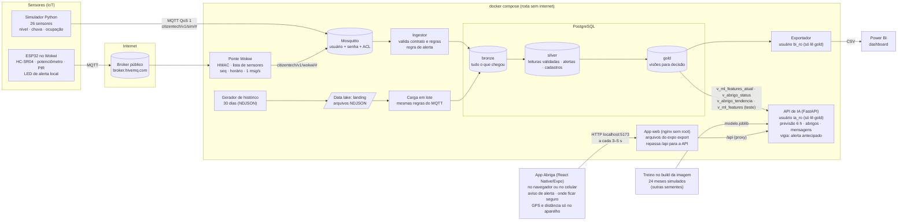

# Arquitetura — fases 1 a 3

## Fluxo de uma leitura

1. O sensor publica um JSON no contrato [`leitura.v1`](../contratos/leitura.v1.schema.json) no tópico `citizentech/v1/{origem}/{sensor_id}`.
2. O Mosquitto confere usuário, senha e permissão. O simulador só publica em `sim/`; a ponte só publica em `wokwi/`.
3. O ingestor processa a leitura:
   1. Grava a mensagem bruta no **bronze**. Uma mensagem idêntica que chega de novo (reentrega do QoS 1) é barrada aqui.
   2. Valida a leitura:
      - schema e tópico;
      - sensor cadastrado e com a origem certa;
      - unidade e faixa de valor;
      - horário.
      Se falhar, a mensagem fica no bronze como `rejeitada`, com o motivo.
   3. Grava no **silver**. Uma leitura com salto de nível impossível vira `suspeita` e fica fora das visões gold.
   4. Se for nível de rio, aplica a regra de alerta: abre, escala ou fecha, com uma folga de 0,10 m para não ficar abrindo e fechando.
4. As visões **gold** respondem às perguntas de decisão:
   - Qual rio está em alerta?
   - Quais abrigos têm vaga e podem ser recomendados?
   - Como foi a série histórica?

## Duas entradas de dados, mesmas regras

| Caminho | Entrada | Uso |
|---|---|---|
| Tempo real | MQTT, uma mensagem por leitura | Situação atual, alertas, app |
| Lote | Arquivos NDJSON na zona de chegada (landing) | Série histórica, dashboard, treino da IA |

As duas entradas chamam a mesma função `processar()` ([`processamento.py`](../area2-bigdata/ingestor/ingestor/processamento.py)).
Por isso um dado nunca entra no banco por um caminho mais frouxo.

## Caminho da IA (fase 2)

1. **Treino** (no `docker build` da imagem da IA): 24 meses simulados com o mesmo simulador
   e outras sementes viram features com a mesma regra da `gold.v_ml_features`. Para cada rio,
   a validação cruzada por semente escolhe entre regra simples, regressão linear e random forest.
2. **Teste**: o modelo é medido nos 30 dias do pipeline, que ele nunca viu
   (`GET /modelo/avaliacao` e o relatório em `area1-ia/relatorio/`).
3. **Uso ao vivo**: a `gold.v_ml_features_atual` entrega as features das últimas leituras. A API
   prevê o nível em 6 h e, com isso, avalia os abrigos (vaga na chegada e risco previsto) e
   escreve as mensagens. O vigia repete a previsão a cada 2 s e abre o alerta antecipado.

## Caminho do app (fase 3)

1. O app pede a situação à API de tempos em tempos: rios e alertas a cada 3 s, abrigos a cada 5 s, com a tela aberta.
   No Docker, o pedido vai para `localhost:5173/api`, e o nginx do app repassa para a API.
2. Quando o vigia abre ou escala um alerta, o app avisa uma vez: com uma faixa no topo e uma notificação do
   navegador ou do celular. O toque leva para "Onde ficar seguro".
3. "Onde ficar seguro" tem dois caminhos:
   - **pelo bairro:** a API recomenda os abrigos a partir do centro do bairro;
   - **pela localização:** a API manda a avaliação de todos os abrigos, sem receber a posição, e o app escolhe os mais perto no aparelho.
4. "Como chegar" abre o mapa a pé só com o destino. Se a API cair, o app mostra os últimos dados com um aviso e volta sozinho.

## Decisões e por quê

| Decisão | Motivo |
|---|---|
| Um contrato JSON Schema compartilhado | Simulador, ESP32 e ingestor falam o mesmo formato. É validado em um lugar só |
| Camadas bronze/silver/gold no PostgreSQL | Guarda o dado bruto para auditoria e mantém o dado tratado separado das visões de decisão |
| Ocupação do abrigo enviada como número absoluto | Se a mesma mensagem chegar duas vezes, o resultado não muda |
| Broker público + ponte para o Wokwi | O Wokwi gratuito não alcança o computador local; a ponte filtra o que chega da internet |
| Migrações próprias (`migrar.py`) | Rodam a cada subida e são idempotentes, e param com erro se uma migração já aplicada for editada. O `initdb.d` do Postgres só roda com o banco vazio |
| Simulação acelerada com "aquecimento" | A demo mostra uma enchente em minutos, e o rio continua de onde o histórico parou |
| IA treinada com histórico simulado e testada no pipeline | 30 dias têm só 1 ou 2 cheias por rio. Treinar e medir nos mesmos eventos daria uma nota enganosa |
| Mesma regra de features no Python e no SQL, com teste de paridade | O modelo aprende com features calculadas em Python e, ao vivo, recebe as do SQL. Se diferissem, a previsão sairia errada sem ninguém perceber |
| Regra simples como candidata no treino | A IA só substitui a persistência onde provou ser melhor (por isso o Dilúvio fica com a regra simples) |
| Modelo treinado no build da imagem | Treino determinístico e sem banco: o modelo nunca fica velho num volume e a API sobe na hora |
| Mensagens por modelos de texto, sem API de LLM | O avaliador não teria a chave. O prompt está documentado, e a verificação automática vale para qualquer gerador |
| Servidor só recebe o bairro; o GPS fica no aparelho | A posição exata do cidadão não sai do celular (LGPD). Com o GPS, o app calcula a distância com a mesma regra da IA, e um teste de paridade compara os dois |
| App em Expo exportado para a web e servido pelo nginx | O mesmo código roda no celular e no navegador; a demo e o avaliador usam o navegador, sem instalar nada além do Docker |
| Proxy `/api` no nginx em vez de CORS | O app e a API ficam no mesmo endereço: sem CORS, funciona com `localhost` ou `127.0.0.1`, e a CSP pode ser `'self'` |
| Aviso pelo app aberto (consulta a cada 3 s), sem push do servidor | Push com o app fechado exige conta e servidor de push, fora do escopo do PRD. O vigia na API já decide quando abrir o alerta; o app só avisa uma vez por alerta novo |
